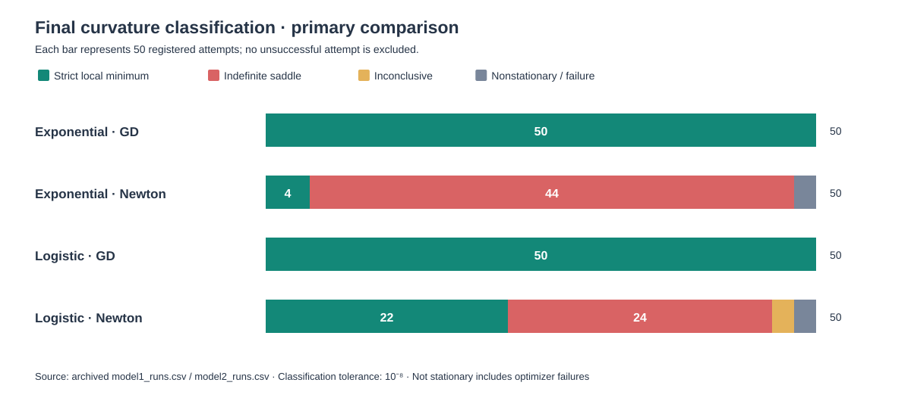
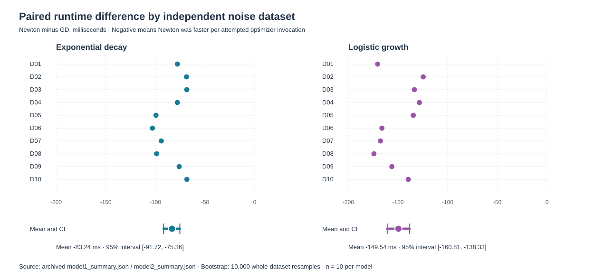

# Comparative Analysis of Gradient Descent and Newton Optimization Methods in Nonlinear Regression Problems

**Working academic report — English**  
**Course:** Optimization Theory (BLM 599), Kocaeli University  
**Instructor:** Prof. Dr. Yaşar Becerikli  
**Student:** Saman Tarighpeima  
**Status:** Complete manuscript draft, 2026-11-21. Final typography, reference QA and page-count verification pending.

## Abstract

This study compares fixed-step batch Gradient Descent (GD) and full-step exact Newton optimization for two nonlinear regression problems: exponential decay and logistic growth. Each three-parameter model was fitted to ten independently noise-seeded synthetic datasets containing 120 observations, with 72 training, 24 validation, and 24 held-out test observations. Five predefined initial parameter vectors were shared across methods for every dataset, producing 50 paired conditions per model. Model-specific GD learning rates were calibrated on separate datasets before evaluation. Optimization outcomes were assessed using gradient-based termination, final Hessian eigenvalues, test mean squared error (MSE), iteration counts, and repeated optimizer-only timing measurements. GD reached Hessian-confirmed strict local minima in all 50 conditions for each model, whereas exact Newton did so in 4/50 exponential and 22/50 logistic conditions; Newton frequently terminated at saddles. Newton had lower computational time per attempted invocation, with mean paired differences (Newton minus GD) of −83.24 ms and −149.54 ms for the exponential and logistic models, respectively. However, its median test MSE was considerably higher in both comparisons. These findings illustrate that rapid gradient-tolerance termination does not necessarily imply successful minimization. Conclusions are limited to the examined synthetic models, selected initializations, and frozen implementations.

**Keywords:** Nonlinear regression; Gradient Descent; Newton's Method; Hessian; Saddle points; Optimization; Reproducible experiments.

## 1. Introduction

Estimating unknown model parameters from observed data is a fundamental task in scientific modeling and statistical analysis. In nonlinear regression, the predicted response depends nonlinearly on one or more unknown parameters, so fitting the model generally requires the iterative minimization of a loss function rather than a direct linear least-squares solution [1]. A common choice is the mean squared error (MSE), which quantifies the average squared difference between model predictions and observed responses. Because the objective is defined over the model parameters, the behavior of an optimization method depends not only on the form of the prediction function but also on the geometry of the resulting loss surface.

Gradient Descent (GD) and Newton's Method represent two established approaches to this optimization problem. GD uses first-order information, moving the parameter vector in the direction opposite to the gradient with a selected step size. Newton's Method additionally uses the Hessian matrix to account for local curvature and determines its update by solving a linear system [2]. This second-order information can provide rapid local progress near a suitable minimum, but each iteration requires additional derivative calculations and a matrix solve. Moreover, when the Hessian is indefinite or poorly conditioned, an unrestricted Newton step is not guaranteed to be a descent step. Analyses of nonconvex optimization therefore distinguish favorable local behavior from the reliability of a method across different initial conditions [2], [3].

This distinction is especially relevant to nonlinear regression because a smooth prediction function does not necessarily produce a convex loss surface in parameter space. The condition that the gradient is close to zero identifies approximate stationarity, not necessarily successful minimization: the corresponding point may be a local minimum, a saddle point, or a case of inconclusive curvature. Published research investigates both the behavior of GD near strict saddle points and Newton-type modifications designed to handle negative curvature [4], [5]. These findings motivate examining solution quality and Hessian curvature separately from a gradient-based stopping criterion. Their theoretical guarantees, however, should not be assumed to apply automatically to a finite experiment with fixed starting vectors and prespecified algorithm settings.

The objective of this study is to compare fixed-step batch GD with full-step exact Newton optimization in two three-parameter nonlinear regression problems: an exponential-decay model and a logistic-growth model. The central research question is: **Under matched data and initialization conditions, how do these first- and second-order methods differ in convergence behavior, execution time, solution quality, numerical stability, and sensitivity to starting parameters?** For each model, ten independently noise-seeded synthetic datasets and five fixed starting vectors are used. Both methods receive identical observations and initial parameters for each paired condition. GD learning rates are calibrated separately using training and validation data and then held fixed; final test observations are excluded from optimization and tuning.

The study contributes a reproducible, controlled comparison based on explicitly implemented analytical derivatives, documented stopping and failure criteria, repeated optimizer-only timing measurements, and Hessian-based classification of final stationary points. Rather than equating a small gradient or short runtime with optimization success, the analysis distinguishes termination status, local curvature, predictive error, and computational cost. The observed outcomes illustrate an important trade-off in this experimental setting: full-step Newton often terminates faster per attempt, while GD more consistently reaches low-error local minima. These conclusions are deliberately limited to the two synthetic model families, registered initializations, and computational conditions examined here.


## 2. Related Work

### 2.1. First-order optimization and step-size selection

Gradient-based minimization remains an important baseline because its parameter updates require first-order derivatives rather than the solution of a Hessian system [2]. Its performance, however, depends strongly on the selection of a step size. Armijo [6] studied a modified steepest-descent scheme in which a candidate step must satisfy a decrease condition, while Wolfe [7] developed convergence conditions for step selection in descent methods. Barzilai and Borwein [8] later proposed two-point gradient step sizes derived from an approximation to a secant relation, illustrating that useful curvature information can be incorporated into a first-order update without forming a full Hessian. These works establish several alternatives to a constant learning rate. **The present study does not implement those alternatives in its primary comparison:** it calibrates one constant GD rate per regression model on separate data and freezes that rate before final evaluation.

### 2.2. Newton updates and safeguards

Newton's Method uses local second-order information and can exhibit rapid convergence in a neighborhood where the Hessian is appropriately conditioned [2]. Such local advantages do not imply that a full Newton update is globally reliable. Cartis, Gould, and Toint [3] investigate worst-case evaluation complexity in nonconvex optimization and demonstrate why the theoretical relationship between steepest descent, Newton, and regularized Newton cannot be reduced to a simple ranking by derivative order. Trust-region techniques, treated systematically by Conn, Gould, and Toint [9], instead limit the region in which a local model is trusted. These safeguards provide valuable context, but they are methodologically distinct from the **unrestricted full-step exact Newton** algorithm used as the primary second-order baseline in this project.

### 2.3. Methods tailored to nonlinear least squares

Nonlinear regression leads naturally to a nonlinear least-squares objective. Dennis and Schnabel [10, Ch. 10] distinguish approaches based on local linearization of the residual vector, notably Gauss–Newton and Levenberg–Marquardt, from methods that treat the full minimization problem. In the original damped least-squares formulation, Levenberg [11] addressed the risk that an excessively large update derived from a linearized model could increase the actual sum of squared residuals. Marquardt [12] further developed an algorithm specifically for nonlinear least-squares parameter estimation, and Moré [13] analyzed implementation issues such as scaling and selection of the regularization parameter.

A distinction is essential for interpreting these methods. With residual Jacobian (J_r), Gauss–Newton uses a matrix proportional to (J_r^T J_r), whereas the **exact Hessian** of an MSE objective also contains terms involving each residual and its second derivatives. Those additional terms need not preserve positive semidefiniteness. Our primary Newton implementation retains them; it must therefore not be described as Gauss–Newton or Levenberg–Marquardt.

### 2.4. Stationary points and negative curvature

Nonconvex optimization introduces another complication: reaching a small gradient does not imply reaching a minimum. Dauphin and colleagues [14] explain how indefinite Hessian curvature can make ordinary Newton updates approach saddle points, and propose a saddle-free alternative in the context of neural-network optimization. Lee and colleagues [4] provide a complementary result concerning gradient descent and strict saddles, but their avoidance theorem requires particular smoothness, step-size, and initialization assumptions. Paternain, Mokhtari, and Ribeiro [5] investigate a separate Newton-based approach that modifies the treatment of negative Hessian eigenvalues.

These studies motivate evaluating **gradient-based termination, Hessian curvature, and final prediction error as separate outcomes**. Their theoretical guarantees and high-dimensional applications do not automatically transfer to our two three-parameter models. Accordingly, this project's contribution is not a new optimizer or a universal performance theorem; it is a reproducible paired experimental comparison of established algorithms, explicitly retaining unsuccessful stationary solutions and numerical failures.

## 3. Mathematical Foundations

### 3.1. Nonlinear regression as a minimization problem

Let $(x_i,y_i)$, $i=1,\ldots,n$, denote observed input–response pairs and let $f(x_i;\boldsymbol{\theta})$ be a nonlinear regression prediction with parameter vector $\boldsymbol{\theta}\in\mathbb{R}^{p}$. Define the residual as the difference between the prediction and the observed response:

$$
r_i(\boldsymbol{\theta})=f(x_i;\boldsymbol{\theta})-y_i.
\tag{1}
$$

In this study, the training objective is the mean squared error (MSE) [1], [15]:

$$
J(\boldsymbol{\theta})=\frac{1}{n}\sum_{i=1}^{n}r_i(\boldsymbol{\theta})^2
=\frac{1}{n}\mathbf r(\boldsymbol{\theta})^T\mathbf r(\boldsymbol{\theta}).
\tag{2}
$$

Here, $n$ counts **training observations**, not all observations in a dataset. The optimizers evaluate (2) using a *candidate* parameter vector and observed training responses. The known parameters used to generate synthetic examples are never passed into the loss function. Although the error in (2) is a sum of squares, it need not be convex in the parameters when the residuals are nonlinear functions of those parameters [15], [16].

### 3.2. The gradient and exact Hessian of MSE

The **gradient** (gradient vector, *gradyan vektörü*) collects the first partial derivatives of the scalar objective. Applying the chain rule to each squared residual gives

$$
\nabla J(\boldsymbol{\theta})
=\frac{2}{n}\sum_{i=1}^{n}r_i(\boldsymbol{\theta})\nabla r_i(\boldsymbol{\theta})
=\frac{2}{n}J_r^T\mathbf r,
\tag{3}
$$

where $J_r\in\mathbb{R}^{n\times p}$ denotes the residual Jacobian, whose $i$th row is $\nabla r_i^T$. Differentiating (3) once more, using the product rule, yields the **exact Hessian** (Hessian or curvature matrix, *Hessian/eğrilik matrisi*):

$$
H_J(\boldsymbol{\theta})
=\nabla^2J(\boldsymbol{\theta})
=\frac{2}{n}\left[
J_r^TJ_r+\sum_{i=1}^{n}r_i(\boldsymbol{\theta})\nabla^2r_i(\boldsymbol{\theta})
\right].
\tag{4}
$$

The first term $J_r^TJ_r$ is positive semidefinite. The second, **residual-weighted curvature term**, can alter the signs of the Hessian eigenvalues. Omitting this second term gives the Gauss–Newton approximation rather than the full Hessian used by exact Newton [10], [15]. This is not merely a distinction in terminology: the implemented algorithm's step direction depends on the complete matrix.

For example, the exponential prediction considered later is $f(x;a,b,c)=ae^{bx}+c$. Writing $E_i=e^{bx_i}$, its prediction derivative is

$$
\nabla_{(a,b,c)}f(x_i;a,b,c)=
\begin{bmatrix}E_i & ax_iE_i & 1\end{bmatrix}^T.
\tag{5}
$$

Substitution of this vector into (3) gives the model's analytical MSE gradient. Its exact Hessian follows from (4), including terms involving $r_i$. The logistic model follows the same general formulas but requires different prediction derivatives. Both sets of analytical derivatives were independently checked in the Python project against numerical finite differences.

### 3.3. First- and second-order parameter updates

A first-order Taylor approximation at the current parameter vector $\boldsymbol{\theta}_k$ is

$$
J(\boldsymbol{\theta}_k+\mathbf p)
\approx J(\boldsymbol{\theta}_k)
+\nabla J(\boldsymbol{\theta}_k)^T\mathbf p.
\tag{6}
$$

Consequently, **fixed-step batch Gradient Descent** updates parameters in the opposite direction to the gradient:

$$
\boldsymbol{\theta}_{k+1}
=\boldsymbol{\theta}_k-\alpha\nabla J(\boldsymbol{\theta}_k),\qquad\alpha>0.
\tag{7}
$$

The learning rate $\alpha$ controls the step size. It remains constant within each model in the official experiment; neither line search nor adaptive rescaling is hidden in the GD baseline.

Newton's Method instead uses a second-order Taylor approximation [2], [17]:

$$
J(\boldsymbol{\theta}_k+\mathbf p)
\approx J(\boldsymbol{\theta}_k)
+\mathbf g_k^T\mathbf p
+\tfrac12\mathbf p^TH_k\mathbf p,
\tag{8}
$$

with $\mathbf g_k=\nabla J(\boldsymbol{\theta}_k)$ and $H_k=\nabla^2J(\boldsymbol{\theta}_k)$. Setting the derivative of this quadratic approximation with respect to $\mathbf p$ to zero leads to $H_k\mathbf p_k=-\mathbf g_k$, giving the **full-step exact Newton** update

$$
H_k\mathbf p_k=-\mathbf g_k,\qquad
\boldsymbol{\theta}_{k+1}=\boldsymbol{\theta}_k+\mathbf p_k.
\tag{9}
$$

When $H_k$ is positive definite, $\mathbf g_k^T\mathbf p_k=-\mathbf g_k^TH_k^{-1}\mathbf g_k<0$ for nonzero $\mathbf g_k$, so Newton's direction is a descent direction. An indefinite Hessian provides no such general guarantee. The implementation therefore checks for singular or ill-conditioned systems and uses a linear-system solve, not an explicitly computed matrix inverse [17]. It does **not** replace an indefinite Hessian with a positive-definite approximation in the primary comparison.

### 3.4. Stationary points and curvature classification

A point $\boldsymbol{\theta}^{*}$ satisfying $\nabla J(\boldsymbol{\theta}^{*})=\mathbf0$ is a **stationary point** (*durağan nokta*), but stationarity alone is insufficient to establish minimization. For a twice continuously differentiable objective at an interior point, a positive-definite Hessian at a stationary point is sufficient for a **strict local minimum**, a negative-definite Hessian indicates a strict local maximum, and an indefinite Hessian identifies a **saddle point**. When the Hessian is only semidefinite, the usual second-order test can be inconclusive [2], [16].

A course-aligned two-parameter illustration is $q(x_1,x_2)=2x_1^2-3x_1x_2+2x_2^2$. Its Hessian is

$$
H_q=\begin{bmatrix}4&-3\\-3&4\end{bmatrix},
\qquad\lambda_1=1,\quad\lambda_2=7.
\tag{10}
$$

Both eigenvalues are positive; hence the stationary point at $(0,0)$ is a strict minimum. In contrast, a Hessian with both positive and negative eigenvalues is indefinite. In the present study, this local classification is computed separately from gradient-tolerance termination and final test MSE. **A small gradient is not, by itself, evidence of a successful minimum.**

## 4. Regression Models and Data

### 4.1. Selected nonlinear regression models

Two smooth, three-parameter regression functions were chosen to compare optimization behavior while keeping model complexity manageable. Both are fitted to **continuous responses**, using the MSE objective introduced in Section 3; the logistic function is used for nonlinear **regression**, not binary classification. These model families provide different parameter interactions and objective landscapes without introducing additional covariates or optimization constraints. The use of nonlinear least squares for parameter estimation is well established [1], [15].

The first model is an **exponential decay with an offset**:

$$
f_1(x;a,b,c)=ae^{bx}+c,\qquad \boldsymbol{\theta}_1=(a,b,c)^T.
\tag{11}
$$

Here $a$ determines the initial contribution above the offset, $b$ controls exponential growth or decay, and $c$ is the additive baseline. The data-generating parameters were $a=4$, $b=-\ln(2)\approx-0.693147$, and $c=1$, corresponding to a decay half-life of one input unit. Thus, for example, the noise-free prediction at $x=0$ is $f_1(0)=5$.

The second model is a **logistic growth curve**:

$$
f_2(x;L,k,x_0)=\frac{L}{1+\exp[-k(x-x_0)]},
\qquad \boldsymbol{\theta}_2=(L,k,x_0)^T.
\tag{12}
$$

With positive $L$ and $k$, $L$ is the upper asymptote, $k$ controls steepness, and $x_0$ identifies the midpoint where the prediction equals $L/2$. The data-generating values were $(L,k,x_0)=(10,1.5,2)$, giving a midpoint prediction of $f_2(2)=5$. The optimization code does not constrain candidate vectors to these positive generating values; deliberately difficult initializations, including negative $k$, remain part of the registered comparison.

### 4.2. Synthetic observations and noise

For each model, 120 equally spaced input locations were constructed over $x\in[0,4]$. Observed responses were generated from the corresponding known curve with additive Gaussian noise:

$$
y_i=f_m(x_i;\boldsymbol{\theta}_{m,\mathrm{true}})+\varepsilon_i,
\qquad \varepsilon_i\overset{\mathrm{iid}}{\sim}\mathcal{N}(0,0.1^2),
\qquad m\in\{1,2\}.
\tag{13}
$$

The noise standard deviation was fixed at $0.1$ for both model families, but each dataset used a distinct pseudorandom noise seed. Ten datasets were generated for each family, yielding **20 distinct model-and-noise realizations** in total. The exponential datasets used seeds 1000–1009, and logistic datasets used seeds 1100–1109. The input grid and clean generating curve remained fixed *within each model* across noise seeds. This controlled design isolates the effect of different noise realizations from changes in the input domain or sample count.

**Table 1. Registered data-generation settings**

| Setting | Exponential decay (Model 1) | Logistic growth (Model 2) |
|---|---|---|
| Prediction function | $ae^{bx}+c$ | $L/[1+\exp(-k(x-x_0))]$ |
| True generating parameters | $(4,-\ln2,1)$ | $(10,1.5,2)$ |
| Input range and observations | $[0,4]$, $120$ | $[0,4]$, $120$ |
| Additive noise standard deviation | $0.1$ | $0.1$ |
| Evaluation noise seeds | 1000–1009 | 1100–1109 |
| Training / validation / test | $72/24/24$ | $72/24/24$ |

### 4.3. Dataset partitioning and information isolation

Each dataset was divided by a reproducible random permutation into **72 training observations (60%)**, **24 validation observations (20%)**, and **24 test observations (20%)**. The split used seed 2026, independent of the noise-generating seed. Consequently, the same 120 input indices received the same train/validation/test labels across dataset realizations; only their noise values changed.

During optimization, GD and exact Newton received **training inputs and observed training responses only**. Validation observations were used during the separate GD learning-rate calibration procedure; the selected rate was then frozen before evaluating the registered datasets. Test observations were reserved for scoring the final estimated parameters after optimization, not for tuning or updates. Although the generating parameters were known for synthetic-data construction and subsequent interpretation, neither optimizer received them.

Each of the ten noise realizations was evaluated from the same five prespecified, model-specific initial parameter vectors for both algorithms. Thus, both methods were compared on exactly matched training data and initializations. The starting vectors and complete calibration/evaluation schedule are reported in Section 6. Since five starts on one dataset share its observations, the analysis treats the **noise-seeded dataset**—not the individual starting point—as the independent resampling unit when quantifying uncertainty.

## 5. Optimization Algorithms

### 5.1. Implementation principles

The two primary optimization methods were implemented explicitly in Python with NumPy rather than delegated to a black-box optimization routine. Each receives a candidate parameter vector $\boldsymbol{\theta}_0$ and the **same training observations** for a paired comparison. The model-specific functions compute MSE and its analytical gradient, while the Newton implementation additionally computes the **exact Hessian** from Eq. (4). Both optimizers use 64-bit floating-point arrays and preserve completed parameter updates, loss histories, gradient norms and termination reasons. The data-generating true parameters and held-out observations are unavailable to either update routine.

### 5.2. Fixed-step batch Gradient Descent

At iteration $k$, batch Gradient Descent evaluates the complete training-set gradient $\mathbf g_k=\nabla J(\boldsymbol{\theta}_k)$ and applies the update in Eq. (7). Its step size $\alpha$ is **constant throughout the run**. Separate preliminary calibration used three independent training/validation datasets per model, five registered initializations, and eight candidate rates. The final values were frozen **before** evaluation: $\alpha=0.10$ for exponential decay and $\alpha=0.03$ for logistic growth. Neither adaptive step sizes, line searches, nor momentum are used in this baseline. Classical gradient convergence results may depend on assumptions such as smoothness, convexity, and a suitably bounded step size; those assumptions are not automatically satisfied by our unconstrained nonlinear MSE objectives [2], [18].

**Algorithm 1. Implemented fixed-step batch GD**

```text
Input: training data, initial theta, frozen alpha, epsilon, cap=10000
Evaluate initial training MSE and gradient g
If ||g||_2 <= epsilon: stop (gradient_tolerance)
For k = 1,...,cap:
    candidate = theta - alpha*g
    Evaluate training MSE and gradient at candidate
    If an update or evaluation is nonfinite: stop (numerical_failure)
    Accept candidate; save completed update and diagnostics
    If ||g||_2 <= epsilon: stop (gradient_tolerance)
If cap is exhausted: stop (max_iterations)
```

Unlike a line-search algorithm, fixed-step GD **does not reject** a finite update merely because training MSE rises. Such increases are retained in its loss history.

### 5.3. Full-step exact Newton

Newton's Method uses both the gradient and the complete three-by-three Hessian of the training MSE [2], [10]. At each iteration it solves the linear system in Eq. (9) for the Newton displacement $\mathbf p_k$. The implementation uses a numerical linear-system solver, not an explicitly formed inverse matrix. It evaluates the Hessian condition number first: a nonfinite value triggers a `singular_hessian` outcome and a value larger than $10^{12}$ triggers `ill_conditioned_hessian`. A failed linear solve also triggers a singular-system outcome.

**Algorithm 2. Implemented exact full-step Newton**

```text
Input: training data, initial theta, epsilon, cap=100
Evaluate initial training MSE and gradient g
If ||g||_2 <= epsilon: stop (gradient_tolerance)
For k = 1,...,cap:
    Compute exact training MSE Hessian H
    If cond(H) is invalid or > 10^12: stop with Hessian reason
    Solve H*p = -g
    candidate = theta + p                 # full step; no damping
    Evaluate training MSE and gradient at candidate
    If solve/update/evaluation fails numerically: stop with failure reason
    Accept candidate; save completed update and diagnostics
    If ||g||_2 <= epsilon: stop (gradient_tolerance)
If cap is exhausted: stop (max_iterations)
```

The Newton solver **does not demand a positive-definite Hessian**, and it **does not reject a finite trial step because MSE increased**. This faithfully exposes limitations of unsafeguarded full-step Newton: for an indefinite Hessian, the direction may fail to decrease the objective and can approach a saddle [3], [14]. The Hessian must not be silently replaced by $J_r^TJ_r$, which would change the algorithm to a Gauss–Newton approximation.

### 5.4. Termination, curvature diagnostics and failure recording

Both primary algorithms stop as soon as the Euclidean gradient norm meets the same tolerance,

$$
\|\nabla J(\boldsymbol{\theta}_k)\|_2\le 10^{-4}.
\tag{14}
$$

The iteration caps are **not equal**: 10,000 updates for GD and 100 for Newton. They are safety limits, not numbers of iterations that every run must execute. An exhausted cap is recorded as **not converged**. Numerical overflow, a nonfinite candidate, and Hessian-system problems are recorded rather than dropped. In either case, the recorded solution is the **last completed finite update** when available. Crucially, the optimizer's internal `converged` field means only *gradient-tolerance termination*, not arrival at a local or global minimum.

After each timed optimization, a separate training-data Hessian diagnostic classifies stationary endpoints using symmetric-matrix eigenvalues. Eigenvalues all above $10^{-8}$ indicate a positive-definite Hessian and a strict local minimum; eigenvalues all below $-10^{-8}$ indicate a negative-definite Hessian; mixed positive and negative eigenvalues indicate an indefinite saddle; otherwise the second-order classification is inconclusive. These are **numerical curvature labels with a specified threshold**, not proof of a global optimum. The post-run curvature check is excluded from optimizer-only timing.

### 5.5. Separately labelled safeguarded method

A third, **exploratory** variant is retained for context but is not part of the primary GD-versus-exact-Newton paired comparison. When the Hessian is not positive definite or sufficiently well conditioned, it substitutes the negative gradient as a descent direction. It also applies an Armijo sufficient-decrease test with geometric backtracking, initially $\alpha=1$, reduction factor $0.5$, and at most 30 reductions [6]. This variant differs from both unrestricted Newton and Levenberg–Marquardt [13]. Its results and additional line-search/fallback costs are reported **separately** in the Results section. The later adaptive-GD exploratory pilots are excluded entirely from the official study.

## 6. Experimental Methodology and Reproducibility

### 6.1. Paired experimental design

The comparison was organized to isolate the optimization method while keeping the data and initial parameter vector fixed within each pair. For each of the two models, ten independently seeded Gaussian-noise realizations (D01–D10) were evaluated from five prespecified starting parameter vectors (S1–S5), producing **50 paired conditions per model** and **100 pairs in total**. Each pair consisted of fixed-step GD and full-step exact Newton applied to the same 72 training observations and identical initial parameters. A third, safeguarded Newton variant was evaluated separately as an exploratory method. Thus the full registered grid comprised **200 primary method conditions and 100 exploratory conditions**. All conditions were retained irrespective of their outcomes. The five starts within one dataset are repeated optimization conditions, **not five independent datasets**.

Starting vectors were deliberately varied to expose sensitivity to initialization without optimizing those choices against the final results. Exponential starts (parameter order $[a,b,c]$) were $[3,-0.5,1]$, $[1,-1.2,0]$, $[6,-0.2,2]$, $[-1,-0.5,3]$, and $[2,0.4,0]$. Logistic starts (parameter order $[L,k,x_0]$) were $[9,1,2]$, $[6,0.5,1]$, $[14,3,3]$, $[10,-1,2]$, and $[7,0.15,0]$. In particular, the negative-$k$ logistic start was kept rather than removed after observing any optimization outcome.

### 6.2. Learning-rate calibration and evaluation isolation

GD's constant learning rate was calibrated **before** the final comparison, using separate noise realizations: seeds 2000–2002 for the exponential model and 2100–2102 for the logistic model. Eight prespecified candidate rates, $\{0.0001,0.0003,0.001,0.003,0.01,0.03,0.1,0.3\}$, were tested across three calibration datasets and all five fixed starts for each model, yielding **120 trials per model (240 total)**. The selection rule first minimized numerical failures; among equally reliable candidates, it minimized the mean validation MSE among finite, nonfailed trials, with the smaller rate as the last tie-breaker. Iteration-cap exhaustion remained explicitly recorded rather than being mistaken for convergence.

This training/validation-only procedure selected $\alpha=0.1$ for exponential decay and $\alpha=0.03$ for logistic growth. Both rates were then frozen across all ten final evaluation datasets and five starting points per model. Neither the final test responses nor the Newton outcomes were consulted during rate selection. Calibration time was excluded from the reported optimizer-only execution times.

### 6.3. Termination, performance measures and computational timing

Each algorithm was evaluated using the common gradient tolerance $10^{-4}$, with the previously registered method-specific limits of 10,000 GD updates and 100 Newton updates (Section 5). Recorded outcomes included the reason for stopping, update count, final gradient norm, objective/gradient/Hessian evaluation counts, final parameter vector, and training, validation and test MSE. Stationarity and successful minimization were assessed separately: **only for a gradient-tolerance termination** was the final training-objective Hessian classified by eigenvalues using threshold $10^{-8}$. Singular or ill-conditioned Hessians, numerical failures and exhausted iteration caps were preserved with their original reason codes. A nonconverged run was not removed merely because its finite final MSE was poor.

Wall-clock time was measured with Python's high-resolution `time.perf_counter` immediately around each complete optimizer invocation. Each method condition was repeated **five times**, always restarting from the same data and initial parameter vector; the median of the five times was the condition-level timing statistic. The timed interval included Newton's Hessian calculations and linear-system solves, but excluded dataset construction, learning-rate calibration, final MSE scoring and post-optimization Hessian classification. The order of GD and Newton was alternated across matched conditions to reduce fixed-order timing bias. The five repetition outcomes were checked for deterministic consistency, and all **1,500 raw timing measurements** (300 method conditions $\times$ five repetitions) were archived.

### 6.4. Paired descriptive statistics and uncertainty

For model $m$, dataset $d\in\{1,\ldots,10\}$ and initial vector $s\in\{1,\ldots,5\}$, let $t^{(N)}_{m,d,s}$ and $t^{(G)}_{m,d,s}$ denote the **median of five optimizer-only timing repetitions** for Newton and GD, respectively. Their paired difference is

$$
\Delta t_{m,d,s}=t^{(N)}_{m,d,s}-t^{(G)}_{m,d,s}.
\tag{15}
$$

A negative value indicates that Newton took less time **per attempted run**, irrespective of whether it reached a minimum. First, the five paired differences within each dataset were averaged:

$$
\overline{\Delta t}_{m,d}=\frac{1}{5}\sum_{s=1}^{5}\Delta t_{m,d,s};
\qquad
\widehat{\mu}_{m}=\frac{1}{10}\sum_{d=1}^{10}\overline{\Delta t}_{m,d}.
\tag{16}
$$

Uncertainty for this mean was estimated with a **paired dataset-level percentile bootstrap** [19]–[21]. For each of 10,000 bootstrap draws, ten dataset identifiers were sampled with replacement, and the statistic $\widehat{\mu}_m$ was recomputed from their ten *whole-dataset* summaries. The five start-specific paired observations within each selected dataset stayed together. The lower and upper interval endpoints were the empirical 2.5th and 97.5th percentiles of the resulting bootstrap means. A fixed base seed of 20261101, with deterministic model-specific offsets, made the resampling reproducible. The published literature supports bootstrap resampling in general [19], [20] and cautions against ignoring within-cluster dependence [21], but **our simple percentile cluster bootstrap is not the more specialized bootstrap-$t$ method studied by Cameron et al.** With only ten independent noise datasets per model, the nominal 95% coverage of these intervals is uncertain; no hypothesis-test $p$-values were claimed.

Timing differences, final MSE values, stationarity rates and Hessian-based outcomes were interpreted **together**. In particular, an algorithm that quickly stops at an indefinite saddle was not credited with having found a satisfactory minimum. The paired timing contrast therefore estimates time **per attempted optimizer invocation**, not time needed to reach equally accurate solutions.

### 6.5. Reproducibility and audit trail

The experiments were executed from a frozen source-code revision with registered model configurations, starting vectors, noise seeds, selected GD rates, stopping rules, and analysis settings. For every dataset the generation procedure saved a content hash. The archive contains one row for each of the 300 registered method conditions, all 1,500 raw timing measurements, and two model-level summary files. The execution provenance records Python 3.12.14, NumPy 2.3.5, code/configuration SHA-256 hashes and the exact data hashes. An independent audit reproduced the 20 dataset hashes, timing medians, paired summaries and bootstrap intervals. These verifications support computational reproducibility of the **archived experiment**; numerical timings on another computer may differ. The archived results were not changed after observing test outcomes.

## 7. Experimental Results

### 7.1. Stationarity and Hessian-based outcomes

All results in this section derive from the **original, audited evaluation archived on 2026-11-01**. The primary analysis contains 50 paired conditions per model (ten independently noise-seeded datasets and five starts per dataset), for 200 GD and exact-Newton method-condition records across the two models. Each method's gradient-tolerance outcome and its final Hessian-based curvature classification are shown separately in Table 2. The denominator is always the full set of 50 registered attempts per model and method; failed runs were not discarded.

**Table 2. Gradient-tolerance terminations and final curvature outcomes (counts of 50)**

| Final diagnostic | Exponential GD | Exponential Newton | Logistic GD | Logistic Newton |
|---|---:|---:|---:|---:|
| Gradient-tolerance termination | 50 | 48 | 50 | 48 |
| Hessian-confirmed strict local minimum | 50 | 4 | 50 | 22 |
| Indefinite saddle | 0 | 44 | 0 | 24 |
| Inconclusive near-zero curvature | 0 | 0 | 0 | 2 |
| Did not reach gradient tolerance | 0 | 2 | 0 | 2 |

Both GD configurations satisfied the gradient threshold and reached Hessian-confirmed strict local minima in **50/50** registered conditions. Exact Newton satisfied the gradient criterion in **48/50** conditions for *each* model, but its strict-local-minimum counts were only **4/50** for exponential decay and **22/50** for logistic growth. Of the stationary Newton endpoints, 44 were classified as indefinite saddles for the exponential model and 24 for the logistic model. Two logistic endpoints had inconclusive near-zero curvature. The remaining two Newton runs per model terminated before satisfying gradient tolerance, due to ill-conditioned Hessian or numerical-failure conditions.



**Figure 1.** Hessian-based classification of the final outcomes for the 200 primary method conditions. Each bar includes every registered condition. Curvature is diagnosed using the training objective and the predeclared eigenvalue tolerance of $10^{-8}$.

### 7.2. Iterations, execution time and predictive error

Table 3 reports the **median over all 50 attempts** for each method and model. Each condition's time is first defined as the median of five fresh optimizer invocations. Accordingly, these timings include incomplete and unsuccessful Newton attempts; they cannot be interpreted as time to an equally accurate fit.

**Table 3. Descriptive outcomes of the primary optimizer comparison**

| Metric (all registered attempts) | Exponential GD | Exponential Newton | Logistic GD | Logistic Newton |
|---|---:|---:|---:|---:|
| Median update count | 1,168 | 9 | 2,804 | 7 |
| Median optimizer-only time (ms) | 66.69 | 1.10 | 147.09 | 1.13 |
| Median final test MSE | 0.008850 | 1.155205 | 0.009147 | 10.805764 |

For exponential decay, exact Newton required a median of **9** updates compared with **1,168** for GD, but had a substantially higher median final test MSE. The same contrast appeared for logistic growth: exact Newton used a median of **7** updates compared with **2,804** for GD, yet the median Newton test MSE remained far higher. These differences do not imply that every Newton attempt had poor predictive quality; some Newton runs reached minima with test errors comparable to GD.

The exponential-model Newton records include a very large but finite test-MSE outlier of approximately **1.132e+12**. The primary table therefore uses medians rather than a mean dominated by this extreme observation. The outlier remains in the original records. Newton had a numerically lower test MSE than its paired GD run in only **3/50** exponential conditions and **14/50** logistic conditions (including very small differences); these are descriptive paired counts, not independent statistical trials.

### 7.3. Paired computational-time differences

For every dataset and start, a paired time difference was calculated as exact-Newton time minus GD time, using the method-specific median of five timing measurements. The five start-specific differences were averaged **within** each independent dataset before estimating the overall mean and its dataset-level bootstrap uncertainty (Eqs. 15–16).

**Table 4. Dataset-level paired runtime differences, Newton minus GD**

| Model | Mean difference (ms) | 95% dataset-bootstrap percentile interval (ms) |
|---|---:|---:|
| Exponential decay | **-83.24** | [-91.72, -75.36] |
| Logistic growth | **-149.54** | [-160.81, -138.33] |



**Figure 2.** The ten independent dataset-level mean paired differences for each model, together with the mean and its 95% percentile-bootstrap interval (10,000 whole-dataset resamples). Negative values mean lower *per-attempt* runtime for Newton. All ten dataset-level differences were negative for both models. The intervals were generated with only ten independent datasets per model and may have imperfect nominal coverage; **no $p$-values were calculated**. They do not measure time required to obtain a strict local minimum or equal test MSE.

### 7.4. Representative paired outcomes

A representative failure mode is seen in exponential dataset **D02**, start **S5**. GD reached a strict local minimum after **2945** updates, with test MSE **0.007642**. Exact Newton stopped after **8** updates with gradient norm **5.31e-7**, but its test MSE was **1.142132**. Newton's final Hessian eigenvalues were approximately **[-1.712, 1.157, 4.556]**, containing both positive and negative values: the endpoint was a saddle, not a strict minimum. This numerical example demonstrates why small-gradient termination alone is insufficient.

To avoid presenting Newton as uniformly unsuccessful, a contrasting case is **logistic dataset D01, start S1**. Both algorithms reached strict local minima; GD took **2563** updates (test MSE **0.010753**) whereas Newton took **4** updates (test MSE **0.010743**). Newton therefore did reach a comparable fitted solution much more quickly **in this particular favorable condition**. These two pairs are selected as transparent illustrations, not as estimates of average success.

### 7.5. Exploratory safeguarded Newton

A separately registered safeguard variant used a gradient fallback for unsuitable Newton directions and Armijo backtracking. It reached Hessian-confirmed strict local minima in **20/50** exponential conditions and **38/50** logistic conditions. The other **30/50** and **12/50** conditions, respectively, reached the 100-update cap before gradient-tolerance termination. Its median per-condition optimizer time was **11.03 ms** (exponential) and **2.59 ms** (logistic), while median test MSE was **0.134525** and **0.010743**. This variant does **not** replace exact Newton in Tables 2–4, nor does it enter their paired timing confidence intervals.

The archive contains final parameter vectors, measured objective values and final Hessian eigenvalues, but not an exported iteration-by-iteration loss trajectory for every registered condition. Therefore, no loss-versus-iteration figure is presented as if it were part of the originally archived observations. Any future trajectory illustration would require a separately labelled diagnostic reconstruction.


## 8. Discussion and Limitations

### 8.1. Why small-gradient Newton terminations did not imply minima

The principal finding of this controlled comparison is the distinction between **stationarity** and **successful minimization**. Exact Newton satisfied the common gradient-norm tolerance in 48/50 conditions for each model, yet reached Hessian-confirmed strict local minima in only 4/50 exponential-decay conditions and 22/50 logistic-growth conditions. The remaining stationary outcomes were predominantly indefinite saddles (44 and 24, respectively), with two additional inconclusive-curvature cases for the logistic model. In contrast, fixed-step GD met the gradient tolerance and attained a positive-definite final Hessian in every registered condition for both models. These classifications come from the measured training-objective Hessian; they do not establish global optimality.

The mechanism is consistent with the known limitations of unmodified Newton steps on nonconvex objectives [3], [14]. Near a stationary point $\boldsymbol{\theta}^*$, let $\boldsymbol{\delta}=\boldsymbol{\theta}-\boldsymbol{\theta}^*$ and approximate $\nabla J(\boldsymbol{\theta})\approx H(\boldsymbol{\theta}^*)\boldsymbol{\delta}$. Where this Hessian is nonsingular, a full Newton displacement is approximately $-H^{-1}H\boldsymbol{\delta}=-\boldsymbol{\delta}$: the update moves toward the stationary point even if some curvature directions are negative. For GD, the corresponding local displacement evolves approximately as $(I-\alpha H)\boldsymbol{\delta}$; along a negative eigenvalue $\lambda<0$, the factor $1-\alpha\lambda$ exceeds one for $\alpha>0$. This helps explain the methods' contrasting local behavior, although it is a **local linearization, not a proof** that the finite runs must follow those trajectories. Moreover, Lee et al.'s strict-saddle avoidance theorem for GD requires specific smoothness, step-size and random-initialization assumptions [4]; our five fixed starts and calibrated rates do not establish those conditions.

### 8.2. Sensitivity to initial parameters

The outcomes were not uniform across initial parameter vectors. Table 5 aggregates Newton's **Hessian-confirmed strict local minima out of ten noise-seeded datasets for each fixed start**. It was calculated from the complete archived run-level records, rather than inferred from a single illustrative trajectory.

**Table 5. Strict local minima reached by exact Newton, grouped by prespecified start (out of ten datasets each)**

| Starting vector ID | Exponential decay | Logistic growth |
|---|---:|---:|
| S1 | 0/10 | 10/10 |
| S2 | 0/10 | 8/10 |
| S3 | 4/10 | 4/10 |
| S4 | 0/10 | 0/10 |
| S5 | 0/10 | 0/10 |

The contrast is particularly clear for the logistic model: Newton reached a strict local minimum for all ten datasets from S1, whereas it did so for none of the ten datasets from S4 or S5. For the exponential model, only S3 ever yielded a strict local minimum for exact Newton. GD reached a Hessian-confirmed strict local minimum in 10/10 datasets for **every** registered starting vector in both models. These observations support an initialization-sensitivity finding **within this deliberately chosen starting-vector set**. They do not estimate the success probability under a broader random-start distribution, and starts sharing the same noise dataset are not independent evidence units.

### 8.3. Computational speed versus solution quality

Exact Newton used far fewer updates and much less optimizer-only time per attempted invocation. The mean dataset-paired differences were approximately $-83.24$ ms for exponential decay and $-149.54$ ms for logistic growth (Newton minus GD). Both reported bootstrap intervals lay below zero in this particular execution environment. These contrasts are meaningful as **per-attempt computational costs**, because the Hessian calculations and linear solves were included in Newton's measured time. They must not be presented as evidence that Newton obtains an equally accurate minimum more quickly *on average*: many rapidly terminated Newton runs ended at saddles with poor predictions.

This distinction is reinforced by final test MSE. The median Newton test errors, 1.155205 for exponential decay and 10.805764 for logistic growth, were markedly higher than GD's 0.008850 and 0.009147. Conversely, the logistic D01/S1 example demonstrates that, from a favorable initialization, exact Newton can reach a strict local minimum with predictive error comparable to GD in very few updates. Therefore, a method comparison that reports only convergence speed or only the subset of successful runs would give an incomplete picture. The single extreme but finite exponential Newton test-MSE value exceeding $10^{12}$ also illustrates why medians were emphasized and raw failures/outliers were retained.

### 8.4. Safeguards and alternatives

The separately labelled safeguarded Newton variant attained strict local minima in 20/50 exponential and 38/50 logistic conditions, compared with 4/50 and 22/50 for unmodified exact Newton. This exploratory improvement in minimum counts did **not** establish superiority to GD: the safeguarded variant exhausted its 100-update budget in 30/50 exponential and 12/50 logistic runs, and its backtracking/fallback costs need to be considered. The result suggests that safeguards can materially change the behavior of a Newton-based method, in line with established work on trust regions, damping and negative-curvature modifications [5], [9], [13]. It is **not** evidence that our exploratory safeguard is equivalent to Levenberg–Marquardt or to the particular modifications studied in those sources. The later adaptive-GD pilots are outside this official evaluation and are not used to modify the principal findings.

### 8.5. Study limitations and interpretation

Several limitations restrict how broadly these findings can be generalized. First, only **two synthetic, three-parameter model families**, a single Gaussian noise standard deviation ($0.1$), and a fixed input domain were examined; performance on other models, noise levels, parameter scales or real data is unknown. Second, the five starts were intentionally selected, not independently sampled from a probability distribution. Third, GD was calibrated using separate validation datasets while primary Newton used an undamped full step, and their registered maximum update counts were **10,000 versus 100**, respectively. This is a controlled comparison of the **specified implementations**, not a claim that all possible GD and Newton configurations received identical tuning or iteration budgets.

Fourth, timing measurements reflect one Python/NumPy execution environment with small $3\times3$ Hessians; costs may shift with hardware, implementation language, parameter dimension and linear-solver efficiency. Fifth, the bootstrap treated ten noise datasets per model as independent sampling units and kept their five paired starts together, but **ten independent groups are few**. Percentile intervals may have imperfect nominal coverage; the clustered-inference literature urges caution with limited group counts [19]–[21]. No $p$-values or general population-level superiority claims were made. Sixth, numerical eigenvalue thresholds and finite gradient tolerances classify *approximate* stationary endpoints; positive-definite local curvature does not establish a global minimum or identical predictive quality.

Taken together, the evidence supports a conditional conclusion: **for these paired nonlinear-regression experiments and these frozen implementations, fixed-step GD was more reliable at finding low-error strict local minima, while full-step exact Newton terminated substantially faster per attempted optimization but frequently at saddles**. The observed trade-off motivates, rather than settles, further research on safeguarded Newton variants, additional starting-point distributions, larger model families and time-to-satisfactory-solution comparisons.

## 9. Conclusion and Future Work

### 9.1. Conclusion

This study examined two established optimization methods—fixed-step batch Gradient Descent (GD) and full-step exact Newton—in parameter estimation for exponential-decay and logistic-growth regression models. The comparison used matched datasets and starting vectors, independently calibrated GD rates, analytical gradients and exact Hessians, documented stopping rules, and audited computation records. A central methodological choice was to distinguish a small final gradient from a Hessian-confirmed strict local minimum and to retain unsuccessful attempts.

Under these experimental conditions, GD reached a strict local minimum in all **50/50** registered attempts for each model. Exact Newton reached strict local minima in **4/50** exponential-decay attempts and **22/50** logistic-growth attempts, while **44** and **24** Newton attempts, respectively, terminated at indefinite stationary saddles. Although Newton required fewer updates and less time per attempted optimizer invocation, its median test MSE was much higher for both models. The contrast shows why optimizer comparisons should report solution quality, curvature and failure outcomes alongside iteration count and elapsed time.

The findings are **conditional**, not a universal ranking of first- and second-order methods. A favorable logistic starting point allowed Newton to reach a comparably accurate strict local minimum in four updates, whereas other initial conditions led to saddles or numerical problems. The experiment thus illustrates both the rapid local behavior of exact Newton and its vulnerability to unfavorable curvature and initialization when full steps are taken without a minimization safeguard. It does not establish that GD is always more reliable or that Newton is always faster for obtaining a useful fitted model.

### 9.2. Future Work

Further evaluation could include additional nonlinear models, real datasets, larger parameter spaces and several noise intensities. More independent noise datasets and systematically sampled starting vectors would allow broader assessment of initialization sensitivity. A subsequent, separately preregistered comparison could examine line-search GD, trust-region methods, Gauss–Newton, Levenberg–Marquardt, and modified or safeguarded Newton algorithms [6], [9], [10], [13]. These alternatives should not be retroactively substituted for the original exact-Newton baseline.

Future studies should also evaluate **time to a satisfactory solution**, rather than time per attempted invocation alone. That requires a predeclared quality criterion, explicit treatment of failed or censored runs, additional computing environments, and uncertainty estimates based on more independent datasets. Such work would address the present study's limitations while preserving its central lesson: an optimizer's reliability cannot be determined from a small gradient or a short runtime alone.

## References
[1] D. M. Bates and D. G. Watts, *Nonlinear Regression Analysis and Its Applications*. New York: Wiley, 1988. doi: [10.1002/9780470316757](https://doi.org/10.1002/9780470316757).

[2] J. Nocedal and S. J. Wright, *Numerical Optimization*, 2nd ed. New York: Springer, 2006. doi: [10.1007/978-0-387-40065-5](https://doi.org/10.1007/978-0-387-40065-5).

[3] C. Cartis, N. I. M. Gould, and Ph. L. Toint, “On the Complexity of Steepest Descent, Newton's and Regularized Newton's Methods for Nonconvex Unconstrained Optimization Problems,” *SIAM Journal on Optimization*, vol. 20, no. 6, pp. 2833–2852, 2010. doi: [10.1137/090774100](https://doi.org/10.1137/090774100).

[4] J. D. Lee, M. Simchowitz, M. I. Jordan, and B. Recht, “Gradient Descent Only Converges to Minimizers,” in *Proceedings of the 29th Conference on Learning Theory*, PMLR, vol. 49, pp. 1246–1257, 2016. [Publisher entry](https://proceedings.mlr.press/v49/lee16.html).

[5] S. Paternain, A. Mokhtari, and A. Ribeiro, “A Newton-Based Method for Nonconvex Optimization with Fast Evasion of Saddle Points,” *SIAM Journal on Optimization*, vol. 29, no. 1, pp. 343–368, 2019. doi: [10.1137/17M1150116](https://doi.org/10.1137/17M1150116).


[6] L. Armijo, “Minimization of Functions Having Lipschitz Continuous First Partial Derivatives,” *Pacific Journal of Mathematics*, vol. 16, no. 1, pp. 1–3, 1966. doi: [10.2140/pjm.1966.16.1](https://doi.org/10.2140/pjm.1966.16.1).

[7] P. Wolfe, “Convergence Conditions for Ascent Methods,” *SIAM Review*, vol. 11, no. 2, pp. 226–235, 1969. doi: [10.1137/1011036](https://doi.org/10.1137/1011036).

[8] J. Barzilai and J. M. Borwein, “Two-Point Step Size Gradient Methods,” *IMA Journal of Numerical Analysis*, vol. 8, no. 1, pp. 141–148, 1988. doi: [10.1093/imanum/8.1.141](https://doi.org/10.1093/imanum/8.1.141).

[9] A. R. Conn, N. I. M. Gould, and Ph. L. Toint, *Trust-Region Methods*. Philadelphia: SIAM, 2000. doi: [10.1137/1.9780898719857](https://doi.org/10.1137/1.9780898719857).

[10] J. E. Dennis Jr. and R. B. Schnabel, *Numerical Methods for Unconstrained Optimization and Nonlinear Equations*. SIAM, 1996 reprint of the 1983 edition. doi: [10.1137/1.9781611971200](https://doi.org/10.1137/1.9781611971200).

[11] K. Levenberg, “A Method for the Solution of Certain Non-Linear Problems in Least Squares,” *Quarterly of Applied Mathematics*, vol. 2, no. 2, pp. 164–168, 1944. doi: [10.1090/qam/10666](https://doi.org/10.1090/qam/10666).

[12] D. W. Marquardt, “An Algorithm for Least-Squares Estimation of Nonlinear Parameters,” *Journal of the Society for Industrial and Applied Mathematics*, vol. 11, no. 2, pp. 431–441, 1963. doi: [10.1137/0111030](https://doi.org/10.1137/0111030).

[13] J. J. Moré, “The Levenberg–Marquardt Algorithm: Implementation and Theory,” in *Numerical Analysis*, Lecture Notes in Mathematics, vol. 630, Springer, pp. 105–116, 1978. doi: [10.1007/BFb0067700](https://doi.org/10.1007/BFb0067700).

[14] Y. N. Dauphin, R. Pascanu, Ç. Gülçehre, K. Cho, S. Ganguli, and Y. Bengio, “Identifying and Attacking the Saddle Point Problem in High-Dimensional Non-Convex Optimization,” in *Advances in Neural Information Processing Systems*, vol. 27, pp. 2933–2941, 2014. [Proceedings](https://proceedings.neurips.cc/paper/2014/hash/04192426585542c54b96ba14445be996-Abstract.html).

[15] Å. Björck, *Numerical Methods for Least Squares Problems*. Philadelphia: SIAM, 1996. doi: [10.1137/1.9781611971484](https://doi.org/10.1137/1.9781611971484).

[16] S. Boyd and L. Vandenberghe, *Convex Optimization*. Cambridge: Cambridge University Press, 2004. [Author-hosted book](https://web.stanford.edu/~boyd/cvxbook/).

[17] P. E. Gill, W. Murray, and M. H. Wright, *Practical Optimization*. London: Academic Press, 1981. [SIAM reprint DOI](https://doi.org/10.1137/1.9781611975604).

[18] Y. Nesterov, *Introductory Lectures on Convex Optimization: A Basic Course*. Boston: Kluwer Academic Publishers, 2004. doi: [10.1007/978-1-4419-8853-9](https://doi.org/10.1007/978-1-4419-8853-9).

[19] B. Efron, “Bootstrap Methods: Another Look at the Jackknife,” *The Annals of Statistics*, vol. 7, no. 1, pp. 1–26, 1979. doi: [10.1214/aos/1176344552](https://doi.org/10.1214/aos/1176344552).

[20] A. C. Davison and D. V. Hinkley, *Bootstrap Methods and Their Application*. Cambridge: Cambridge University Press, 1997. [Publisher record](https://www.cambridge.org/core/books/bootstrap-methods-and-their-application/ED2FD043579F27952363566DC09CBD6A).

[21] A. C. Cameron, J. B. Gelbach, and D. L. Miller, “Bootstrap-Based Improvements for Inference with Clustered Errors,” *The Review of Economics and Statistics*, vol. 90, no. 3, pp. 414–427, 2008. doi: [10.1162/rest.90.3.414](https://doi.org/10.1162/rest.90.3.414).
